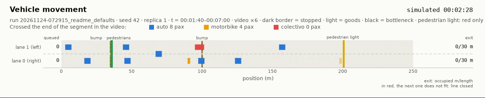

# sim — traffic and train simulations

**traffic** is a traffic microsimulation: each vehicle is simulated on its own. Cars, bikes, buses and any
other type defined in the configuration drive along a straight road with configurable length and lanes, speed bumps,
pedestrian crossings and a traffic light. It runs on the CPU only (NumPy, no GPU) and spreads Monte Carlo replicas
across processes. **rail** simulates the Chepe train (Los Mochis ↔ Chihuahua, Copper Canyon) and renders a
landscape video.



*One frame of `traffic-view` with the default `config.toml`, showing a 250 m road with 2 lanes, two speed bumps, a
pedestrian crossing and a pedestrian light.*

## Install and run (uv)

```bash
uv sync                                   # create .venv with the dependencies
uv run traffic                            # root config.toml -> results/<ID>_<name>/
uv run traffic regular_traffic            # same config, run named regular_traffic
uv run traffic results/<ID>_<name>     # replay a run from its copy of config.toml
uv run traffic-view                        # movement video + space-time diagram of the latest run
```

The single optional argument is either an existing folder (its `config.toml` is used) or a run name. Every parameter
is read from `config.toml`; missing keys take their defaults, and unknown keys or wrong types stop the run with a clear
message. The full reference is in [`docs/config.html`](docs/config.html).

| Command | What it does |
|---|---|
| `traffic` | Run the simulation and write the plots, `summary.txt` and a copy of `config.toml` |
| `traffic-view` | Re-simulate one replica of a run and save a top-down video and a space-time diagram |
| `traffic-variants` | Compare variants: road lengths, light splits, number of lanes |
| `traffic-emissions` | Compare emissions with different speed bumps and traffic lights |
| `traffic-calibrate` | Measure a vehicle type against published reference values (saturation flow, capacity) |
| `rail` | Train simulation: timetable, `route.png` and a video; see [`docs/rail.html`](docs/rail.html) |

## Results

Each run writes to its own folder, `results/<YYYYMMDD-HHMMSS>_<name>/`, and never overwrites another one. The copy
of `config.toml` inside it, which includes the seed, is enough to reproduce the run:

```bash
uv run traffic results/20260924-090500_regular_traffic
```
